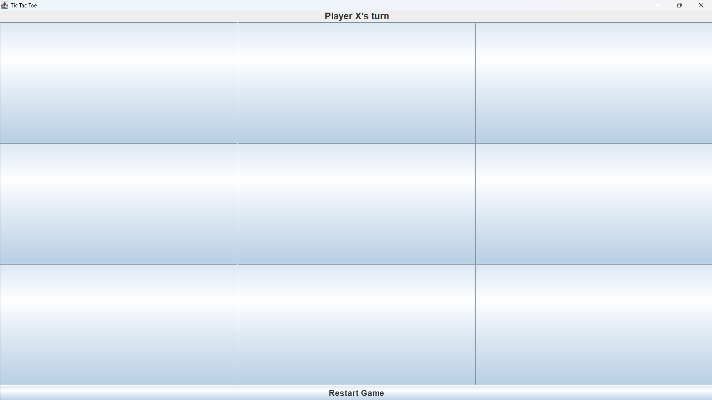
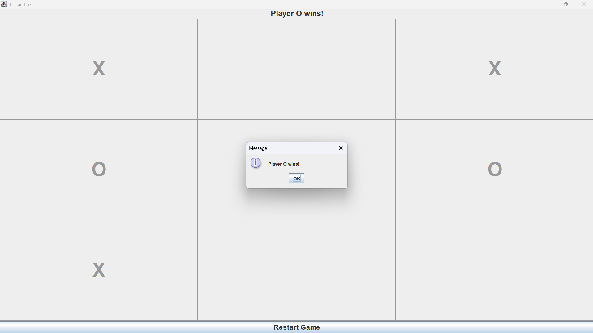
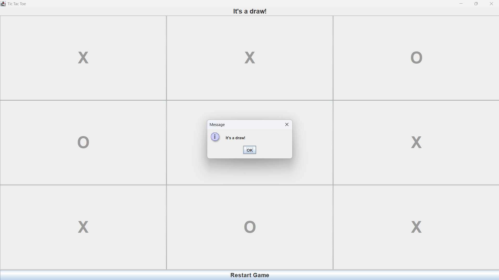

# Tic Tac Toe (Java Swing)

A simple two-player Tic Tac Toe game built in Java using Swing, made in IntelliJ IDEA.

## Features
- 3x3 board using JButtons
- Two players: X and O take turns
- Detects win and draw
- Restart button to play again

## Screenshots

### Start screen

### Player wins

### Draw

## How to run
1. Open the project in IntelliJ IDEA
2. Open `src/TicTacToe.java`
3. Click the green Run button